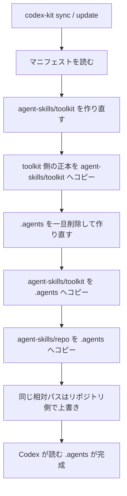
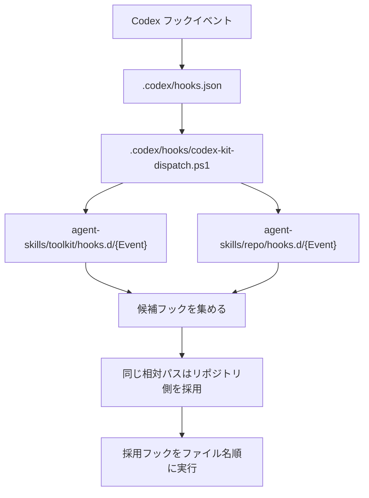

# Toolkit 配布モデル

この文書は、`codex-toolkit` がスキル、フック、ルールをどこへ置き、対象リポジトリへどう同期するかを説明する。

## 先に結論

- `codex-toolkit` は、複数リポジトリへそのまま常駐させるスキルの山ではなく、Codex 運用資産の上流リポジトリとして扱う。
- 対象リポジトリには、toolkit 由来の生成レイヤー `agent-skills/toolkit` と、リポジトリ固有の正本レイヤー `agent-skills/repo` を置く。
- Codex が実際に読む `.agents` は生成物として扱い、`codex-kit sync` / `update` で作り直す。
- リポジトリ固有のスキルやフックは `.agents` に直接書かず、`agent-skills/repo` に置く。
- Codex 標準フックの入口は `.codex/hooks.json` に固定し、実際のフック本体は `agent-skills/toolkit/hooks.d` と `agent-skills/repo/hooks.d` から振り分ける。

## この文書を読む時

知りたいことごとに見る場所を分ける。

| 知りたいこと | 見る場所 |
|---|---|
| 編集してよい場所と生成物の違い | レイヤーモデル、作成・編集ルール |
| `sync` / `update` で何が起きるか | レイヤーモデル、sync ルール |
| フックがどこから実行されるか | レイヤーモデル、フック振り分けルール |
| `init` の対話や manifest の保存内容 | CLI の全体像、init の対話、リポジトリマニフェスト |
| 配布時に守る安全条件 | 安全ルール |

## 基本方針

各リポジトリでは、toolkit 由来のレイヤーとリポジトリ固有のレイヤーを重ね、Codex が読む `.agents` の実行時ツリーと Codex 標準フックの入口を生成する。

ここでは、編集する正本と Codex が読む生成先ランタイムを分ける。
`agent-skills/toolkit` は toolkit 由来の正本を対象リポジトリ内へ反映したレイヤー、`agent-skills/repo` はリポジトリで編集・育成する正本レイヤー、`.agents` は Codex が実際に読む生成先ランタイムレイヤー。
Codex 標準フックは `.codex/hooks.json` を薄い振り分け入口とし、実際のフック本体は正本レイヤーの `hooks.d/<Event>` に置く。
配備先という言葉だけだと曖昧なので、CLIやドキュメントでは正本ルート / 生成先ランタイムルートと呼び分ける。

この `codex-toolkit` リポジトリ内では、各リポジトリへ配る資源を `resources/` 配下に集める。
`bin/`、`lib/`、`scripts/` は `codex-kit` 自体の実行・保守用、`docs/` は配布モデルとスキル棚卸し、`resources/` は配布・生成に使う正本として分ける。

```txt
codex-toolkit/
|-- bin/                  # codex-kit の公開入口
|-- lib/codex-kit/        # CLI 実装本体
|-- scripts/              # install / test / validate
|-- docs/                 # 配布モデルと棚卸し
`-- resources/            # 配布・生成に使う正本
    |-- global/
    |   `-- AGENTS.common-rules-template.md
    |-- hooks/
    |   |-- global/hooks.d/<Event>/
    |   `-- profiles/<profile>/hooks.d/<Event>/
    |-- skills/
    |   |-- global/<skill>/
    |   `-- profiles/<profile>/<skill>/
    `-- templates/
        |-- repo/
        |-- codex-kit/
        `-- codex-requirements/
```

## 目的

- 全リポジトリ向けに常駐させるスキルを、未知のリポジトリで発火しても困らないものへ絞る。
- project type ごとの知見はプロファイルとして toolkit に保管し、リポジトリ側で必要なものだけ使う。
- リポジトリで育てた資産はリポジトリレイヤーに置き、toolkit update で消えないようにする。
- Codex が読む `.agents` は生成物として扱い、直接編集しない。
- Codex が読むフックの入口は `.codex/hooks.json` に固定し、toolkit / repo のフック本体は正本レイヤーで育てる。
- `.env` や秘密鍵の読み取り防止はリポジトリ側フックだけに寄せず、Codex の管理側強制設定の `permissions.filesystem.deny_read` を本命にする。
- リポジトリの常設指示はリポジトリルートの `AGENTS.md` へ反映し、`~/.codex/AGENTS.md` へ toolkit ルールを常時マージしない。
- 普段使いは `codex-kit update` 一発で、toolkit 更新とリポジトリへの反映まで済ませる。

## レイヤーモデル

個人開発では、まず `toolkit` と `repo` の2レイヤーで運用する。
将来、PCごとの上書きが欲しくなった時だけ `user-local` レイヤーを足す。

| レイヤー | 置き場所 | Git管理 | 役割 |
|---|---|---|---|
| Toolkit 側の正本 | `codex-toolkit/resources/skills/global`、`codex-toolkit/resources/skills/profiles/<profile>` | toolkit リポジトリで管理 | 共通スキルと用途別プロファイルの上流 |
| 対象リポジトリ内の toolkit レイヤー | `<repo>/agent-skills/toolkit` | 対象リポジトリでは管理外 | 選択プロファイルをリポジトリ内へ持ってきた toolkit レイヤー |
| リポジトリ側の正本 | `<repo>/agent-skills/repo` | 対象リポジトリで管理 | そのリポジトリ用に編集・育成する上書きレイヤー |
| 生成先ランタイム | `<repo>/.agents` | 対象リポジトリでは管理外 | Codex が実際に読む実行時ツリー。`codex-kit sync` が再生成する |
| Codex フックの入口 | `<repo>/.codex/hooks.json`、`<repo>/.codex/hooks/codex-kit-dispatch.*` | toolkit 管理 | Codex が読む薄いフック入口。`hooks.d` をレイヤー順に実行する |

生成順は toolkit からリポジトリの順にする。
同じ相対パスがある場合は後勝ちで、リポジトリ側の正本が対象リポジトリ内の toolkit レイヤーを上書きする。



`.agents` へ入る時は、先に toolkit レイヤーを入れ、その後にリポジトリレイヤーを重ねる。
そのため、同じ `skills/foo/SKILL.md` が両方にある場合は、最後にコピーされる `agent-skills/repo/skills/foo/SKILL.md` が勝つ。
リポジトリ固有の上書きは `.agents` に直接書かず、必ず `agent-skills/repo` 側へ置く。

```txt
codex-toolkit/resources/skills/global
codex-toolkit/resources/skills/profiles/<selected>
  -> <repo>/agent-skills/toolkit/skills

<repo>/agent-skills/toolkit/*
<repo>/agent-skills/repo/*
  -> <repo>/.agents/*
```

`.agents` は生成物なので、`codex-kit sync` や `codex-kit update` のたびに中身を削除して作り直してよい。
直接編集したい内容は、必ず `agent-skills/repo` の対応する相対パスへ置く。
toolkit 由来のレイヤーを診断したい時は `agent-skills/toolkit` を見る。

Codex 標準フックは `.agents` ではなく `.codex` から読まれるため、`.codex/hooks.json` は振り分けスクリプトだけを呼ぶ。
`codex-kit` はフック定義そのものを都度マージせず、イベント別ディレクトリをレイヤー順に重ねて実行する。

フックは `.agents` へコピーして終わりではなく、`.codex/hooks.json` から振り分けスクリプトを経由して実行時に解決する。
レイヤーの勝ち負けはスキルと同じくリポジトリ側が後勝ちだが、フックの入口そのものは `.codex/hooks.json` に固定する。



```txt
<repo>/.codex/hooks.json
  -> <repo>/.codex/hooks/codex-kit-dispatch.ps1

<repo>/agent-skills/toolkit/hooks.d/<Event>/*
<repo>/agent-skills/repo/hooks.d/<Event>/*
  -> 振り分けスクリプトがイベントごとにレイヤー順で実行
```

同じ相対パスのフックがある場合はリポジトリ側の正本が勝つ。
たとえば `agent-skills/repo/hooks.d/PreToolUse/generated-runtime-protect.ps1` があれば、toolkit 側の同名フックは実行しない。
追加したいだけなら別名にする。

Codex のフックイベントディレクトリは、入力ミスを避けるために次を事前に作る。

```txt
hooks.d/
  PreToolUse/
  PermissionRequest/
  PostToolUse/
  PreCompact/
  PostCompact/
  SessionStart/
  SubagentStart/
  SubagentStop/
  UserPromptSubmit/
  Stop/
```

配布先リポジトリの `.codex/hooks.json` は手編集しない。
リポジトリでフックを育てる時は `agent-skills/repo/hooks.d/<Event>` に置く。
toolkit から配るフックは `codex-toolkit/resources/hooks/global/hooks.d/<Event>` または `codex-toolkit/resources/hooks/profiles/<profile>/hooks.d/<Event>` に置き、sync 時に `agent-skills/toolkit/hooks.d` へ反映する。
例外として、この `codex-toolkit` リポジトリ自体の自己監視フックは配布対象ではないため、リポジトリ固有の `.codex/hooks.json` と `.codex/hooks/*` へ直接置く。

## 作成・編集ルール

スキル、サブエージェント、ランタイム用メタデータを作る、更新する、削除するメタスキルやスクリプトは、必ず正本ルートを対象にする。
ランタイムルートである `.agents` に作ったファイルは、次回の `codex-kit sync` / `codex-kit update` で消える。
新しくスキル、エージェントメタデータ、フックを作る時は、先に `skill-authoring` を使って正本ルートと配布レイヤーを判定する。

| 操作 | 対象 |
|---|---|
| リポジトリ固有スキルを新規作成する | `agent-skills/repo/skills/<skill>` |
| リポジトリ固有スキルを修正・削除する | `agent-skills/repo/skills/<skill>` |
| リポジトリ固有ランタイム資産を作成する | `agent-skills/repo/<relative-path>` |
| リポジトリ固有フックを作成・修正する | `agent-skills/repo/hooks.d/<Event>/<name>.*` |
| toolkit 側の共通スキルを修正する | `codex-toolkit/resources/skills/.../<skill>` |
| toolkit 側の共通フックを修正する | `codex-toolkit/resources/hooks/global/hooks.d/<Event>/<name>.*` |
| toolkit 由来スキルの反映済みレイヤーを確認する | `agent-skills/toolkit/skills/<skill>` |
| 実行時に Codex が読むスキルを確認する | `.agents/skills/<skill>` |
| 同期結果や上書きを診断する | `agent-skills/toolkit`、`agent-skills/repo`、`.agents`、`.codex/hooks.json` |

スキル本文から他スキルの参考メモ / 同梱資産を参照する時は、まずスキル名とスキル内相対パスで書く。
`.agents/skills/...` の絶対的な直書きは、ランタイム生成結果を診断する時だけにする。

## リポジトリ側の形

`codex-kit init` 後のリポジトリは、まず次の形を目標にする。
toolkit 由来の資産は `agent-skills/toolkit` へ反映するが、git管理しない。
リポジトリ側で育てる資産は `agent-skills/repo` に置く。
`codex-kit sync` 後、両方を重ねた結果が `.agents` へ生成される。
toolkit 由来の共通ルールテンプレートは、リポジトリルートの `AGENTS.md` に管理ブロックとして反映する。

```txt
sample-project/
  agent-skills/
    toolkit/
      skills/
        # 生成された toolkit レイヤー:
        # - toolkit/global
        # - toolkit/profiles/<selected>
    repo/
      skills/
        # リポジトリ固有に編集・育成するスキルだけを置く
      agents/
        # リポジトリ固有に編集・育成するランタイムメタデータを置く場合の例
      hooks.d/
        PreToolUse/
        PermissionRequest/
        PostToolUse/
        PreCompact/
        PostCompact/
        SessionStart/
        SubagentStart/
        SubagentStop/
        UserPromptSubmit/
        Stop/
  .agents/
    skills/
      # 生成されたランタイム:
      # - agent-skills/toolkit/skills
      # - agent-skills/repo/skills
    agents/
      # 生成されたランタイムメタデータ
  .codex/
    hooks.json
    hooks/
      codex-kit-dispatch.ps1
  .codex-kit/
    manifest.json
  AGENTS.md
```

- `agent-skills/toolkit` は toolkit 由来資産を対象リポジトリ内へ反映したレイヤー。git管理せず、直接編集しない。
- `agent-skills/repo` はリポジトリ固有資産の正本ルート。スキルは `agent-skills/repo/skills` に置く。
- `.agents` は生成先ランタイムルート。Codex が読むが、`.gitignore` に入れて直接編集しない。
- `.codex/hooks.json` は Codex 標準フックの toolkit 管理入口。フック本体は `agent-skills/repo/hooks.d` で育てる。
- `AGENTS.md` はリポジトリで Git 管理する。toolkit 管理ブロックは `codex-kit init` / `codex-kit update` が更新し、リポジトリ固有差分は同じファイルの外側に残す。
- `.codex-kit/manifest.json` は選択プロファイルと同期設定を記録する。
- `.codex-kit/cache` のような一時領域を作る場合は `.gitignore` に入れる。

## AGENTS.md 反映

リポジトリ内に toolkit レイヤーを配備する場合、共通ルールテンプレートの反映先は対象リポジトリの `AGENTS.md` にする。

`codex-kit init` / `codex-kit update` は、次のような管理ブロックをリポジトリの `AGENTS.md` に挿入または更新する。

```md
<!-- codex-kit:repo-rules:start -->
...
<!-- codex-kit:repo-rules:end -->
```

`AGENTS.md` 管理ブロックは、共通ルールテンプレートと選択プロファイルから組み立てる。
全リポジトリ向けプロファイルの原則に加え、リポジトリが選んだプロファイルの短い入口だけを入れ、詳細手順はスキル本文へ寄せる。
リポジトリ固有の常設指示は管理ブロックの外に置く。

## CLI の全体像

`codex-kit` は PATH から呼べる小さな配布 CLI として扱う。
普段は `update` コマンド一発でよいが、切り分け用に低レベルのコマンドも残してある。
対話文、標準出力 / 標準エラー、コメントなど、人が読む文は日本語を基本にする。
コマンド名、オプション名、JSONキー、プロファイルID、環境変数名のような識別子は、互換性のため英字のまま維持する。

```powershell
codex-kit update
codex-kit update --dry-run
codex-kit init
codex-kit init --preset android-mobile
codex-kit init --preset scheduled-batch
codex-kit init --profile scheduled-batch --profile notifications
codex-kit sync
codex-kit self-update
codex-kit status
codex-kit list-profiles
codex-kit doctor
codex-kit harden --dry-run
```

| コマンド | 責務 |
|---|---|
| `update` | `self-update` と `sync` を順に実行する普段使いの入口 |
| `self-update` | `codex-toolkit` 自体を `git pull --ff-only` で更新する |
| `sync` | `agent-skills/toolkit` と `.agents` をレイヤー順に再生成し、リポジトリの `AGENTS.md` の toolkit 管理ブロックと `.codex/hooks.json` の振り分け入口を更新する |
| `init` | 対話形式でマニフェスト / プロファイルを選び、現在のリポジトリにマニフェスト、リポジトリレイヤー、`.gitignore` 雛形、リポジトリの `AGENTS.md` 管理ブロックを初期配置する |
| `status` | 選択プロファイル、toolkit のコミット、同じ相対パスの勝ちレイヤーを表示する |
| `list-profiles` | toolkit にあるプロファイル一覧を表示する |
| `doctor` | PATH、マニフェスト、正本ルート、生成先ランタイムルート、Codex の読込候補を点検する |
| `harden` | `permissions.filesystem.deny_read` など、リポジトリ同期ではなく個人環境または管理環境へ入れる Codex の管理側強制設定を `--dry-run` で点検する。実反映はまだ未実装 |

`update` は一発コマンドだが、内部の責務は分ける。
`self-update` が失敗した場合は `sync` へ進まない。

## init の対話

`codex-kit init` は既定で対話形式にする。
ユーザーに細かいプロファイル名を直接選ばせず、作るものや盛り込む機能を一覧で複数選ばせ、その回答からプロファイルを組み立てる。
候補一覧を表示し、番号をカンマまたはスペース区切りで入力する。
迷ったら何も入力せず Enter で `basic` 扱いにする。

```txt
作るもの・盛り込む機能に近い番号を選んでください。
複数ある時は、カンマかスペースで区切って入力できます。
迷ったら何も入力せず Enter で基本構成にします。
  1. 基本だけ / まだ未定
  2. 定期実行 / 巡回バッチ
  3. 署名付きwebhook受信 / bot
  4. Godot 4 / C#ゲーム
  5. ノベルゲーム / 分岐シナリオ
  6. codex-toolkit 自体
  7. Androidアプリ
  8. 外部API / Webページからデータ取得
  9. Discord / Slack / Teams / webhook 通知
 10. 設定画面 / 管理画面 / 設定ファイル / CLIオプション
 11. デプロイ / migration / IaC / DB権限変更

番号（例: 4 2 5）:
```

対話を使えない CI やスクリプトでは、プリセットやプロファイル指定オプションを使う。
プリセットは複数プロファイルを選ぶショートカットとして扱う。

```powershell
codex-kit init --preset android-mobile
codex-kit init --preset scheduled-batch
codex-kit init --profile scheduled-batch --profile notifications
codex-kit init --non-interactive --preset basic
```

`init` は既存マニフェストがある時、既定では上書きしない。
プロファイルを追加したい場合は、将来 `codex-kit manifest add-profile <name>` のような別コマンドに分ける。
初期化後は `codex-kit sync` を実行し、`agent-skills/toolkit`、`.agents`、`.codex/hooks.json` の振り分け入口を生成する。

プロファイルの置き場所と追加判断は `docs/SKILL_LAYER_INVENTORY.md` を正本にする。

## リポジトリマニフェスト

`codex-kit init` はリポジトリルートに `.codex-kit/manifest.json` を作る。
マニフェストは、選択プロファイルと生成先を記録する。
リポジトリ固有資産の中身はマニフェストではなく `agent-skills/repo` を正本ルートにする。

```json
{
  "version": 1,
  "manifestPreset": "scheduled-batch",
  "profiles": ["global", "scheduled-batch"],
  "toolkitSourceRoot": "agent-skills/toolkit",
  "repoSourceRoot": "agent-skills/repo",
  "generatedRuntimeRoot": ".agents",
  "hookEntrypoint": ".codex/hooks.json",
  "hookDispatcher": ".codex/hooks/codex-kit-dispatch.ps1",
  "toolkitCommit": "abc123"
}
```

`toolkitCommit` は最後に sync した toolkit のコミットの観測値として扱う。
リポジトリ固有資産の更新履歴は、そのリポジトリの git history に任せる。

## sync ルール

`codex-kit sync` は、次の順で処理する。

1. マニフェストを読む。
2. toolkit の選択プロファイルと全リポジトリ向け資産を列挙する。
3. `toolkitSourceRoot` を作り直し、toolkit 側の正本を対象リポジトリ内の toolkit レイヤーへコピーする。
4. リポジトリ側の正本の相対パスを列挙する。
5. `generatedRuntimeRoot` の中身を削除して作り直す。
6. 対象リポジトリ内の toolkit レイヤーを生成先ランタイムルートへコピーする。
7. リポジトリ側の正本を生成先ランタイムルートへコピーし、同じ相対パスを後勝ちで上書きする。
8. `.codex/hooks.json` と振り分けスクリプトを生成する。
9. 振り分けスクリプトが読むフックの正本を、`agent-skills/toolkit/hooks.d`、`agent-skills/repo/hooks.d` の順で確認する。
10. どのパスがどのレイヤーで勝ったかを表示する。

`--dry-run` ではファイルを書かず、生成予定、削除予定、リポジトリ側で上書きする項目を表示する。

### フック振り分けルール

`.codex/hooks.json` は、Codex の各フックイベントから振り分けスクリプトを呼ぶだけの薄い入口にする。
同じ `.codex` レイヤーに `hooks.json` と inline `[hooks]` を両方置く運用は警告の原因になるため、リポジトリ配布では `hooks.json` に統一する。

振り分けスクリプトは stdin の `hook_event_name` を読み、対応する `hooks.d/<Event>` を探す。
対象イベントのディレクトリは `PreToolUse`、`PermissionRequest`、`PostToolUse`、`PreCompact`、`PostCompact`、`SessionStart`、`SubagentStart`、`SubagentStop`、`UserPromptSubmit`、`Stop`。

実行順は次の通り。

1. `agent-skills/toolkit/hooks.d/<Event>` を列挙する。
2. `agent-skills/repo/hooks.d/<Event>` を列挙する。
3. 同じ相対パスがあるフックはリポジトリ版を採用し、toolkit 版を落とす。
4. 採用したフックをファイル名の昇順で実行する。

フックの正本ファイルは、ほかのフックとの実行順に依存しないように作る。
振り分けスクリプトは結果を安定させるためにファイル名順で実行するが、順序制御をフックの前提にしない。
リポジトリ側で toolkit フックを育てる時は、同じ event ディレクトリと同じファイル名にする。
`.codex/hooks.json` の配列同士を直接マージしない。

### 管理側強制設定

Codex 全体で読ませたくないファイルは、リポジトリ配布のフックではなく管理側強制設定で止める。
`resources/templates/codex-requirements/requirements.secret-read-deny.toml` は、そのための雛形として扱う。
公式ドキュメントでは `permissions.filesystem.deny_read` は exact path または glob pattern を受ける。
`~` は HOME / USERPROFILE 相対として使えるが、`./` から始まる相対パスは使わない。
native Windows では direct file tool には効くが、shell subprocess の read には効かないため、リポジトリ配布フックの変更・stage 防止は補助として残す。

```toml
[permissions.filesystem]
deny_read = [
  "**/.env",
  "**/.env.local",
  "**/.env.*.local",
  "**/id_rsa",
  "**/id_ed25519",
]
```

この雛形は `codex-kit sync` でリポジトリへは配らない。
将来の `codex-kit harden` や installer が、個人環境または管理環境の `requirements.toml` へ反映する対象にする。
既定の配置候補は Windows では `%ProgramData%\OpenAI\Codex\requirements.toml`、Linux / macOS では `/etc/codex/requirements.toml`。

### 初期グローバルフック

toolkit のグローバルフックは、未知のリポジトリでも誤爆しにくい防止処理に絞る。

| フック | 対象イベント | 挙動 |
|---|---|---|
| `generated-layer-guard.ps1` | `PreToolUse` | codex-kit が生成・管理する場所への直接変更を止める。対象は `.agents`、`agent-skills/toolkit`、`.codex/hooks.json`、`.codex/hooks/codex-kit-dispatch.*`。`codex-kit init/sync/update` は許可する。 |
| `secret-file-mutation-guard.ps1` | `PreToolUse` | `.env` や秘密鍵など、機密情報が入っていそうなファイルの変更、コピー、stage を止める。読み取り防止は管理側強制設定の `permissions.filesystem.deny_read` を本命にする。 |

強制力が必要なものは `PreToolUse` に置く。
プロファイル固有のフックはグローバルへ増やさず、`resources/hooks/profiles/<profile>/hooks.d/<Event>` に置く。

### codex-toolkit 開発用フック

`codex-toolkit` リポジトリ自体の検証注意は配布対象にしない。
開発用リポジトリでは `.codex/hooks.json` と `.codex/hooks/toolkit-validation-reminder.ps1` で直接設定する。
公開 snapshot や配布先リポジトリへは入れず、`agent-skills/toolkit` にも反映しない。

## 安全ルール

- `codex-kit update` はリポジトリ側の正本を上書きしない。
- `agent-skills/toolkit` の中身は消えてよい生成物として扱う。
- `generatedRuntimeRoot` の中身は消えてよい生成物として扱う。
- 配布先リポジトリの `.codex/hooks.json` と `.codex/hooks/codex-kit-dispatch.*` は toolkit 管理の入口として扱い、フック本体は正本レイヤーに置く。
- `init` は既存の `agent-skills/repo` を上書きしない。
- `self-update` は `git pull --ff-only` を使い、マージが必要なら止める。
- リポジトリ側の正本に同じ相対パスがある場合、status / sync の出力に上書きとして表示する。
- `.agents` を直接編集していた場合、その変更は次回 sync で消える。必要な内容はリポジトリ側の正本へ移す。
- 配布先リポジトリの `.codex/hooks.json` を直接編集していた場合、その変更は次回 sync で消える。必要なフックは `agent-skills/repo/hooks.d/<Event>` へ移す。
- `generatedRuntimeRoot` はリポジトリ内の `.agents` に限定し、リポジトリルートやリポジトリ外のパス、symlink 展開先を削除対象にしない。
